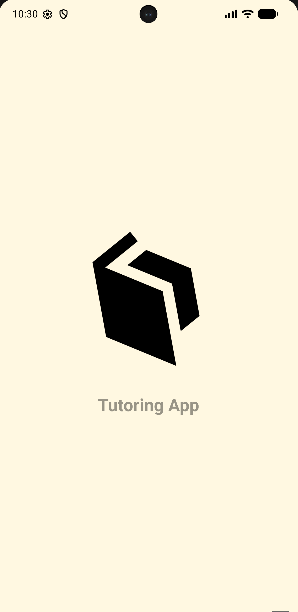
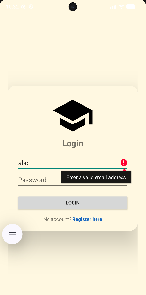
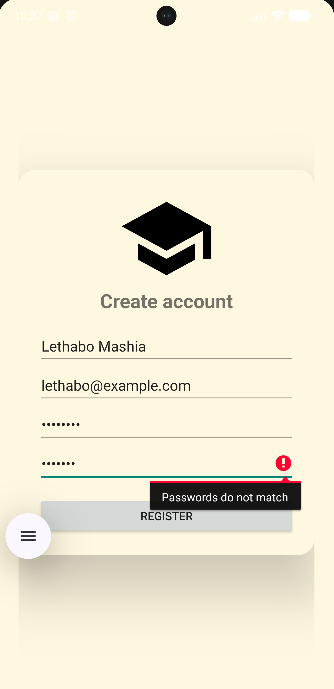

# Tutoring Application

An Android app with real local user accounts: register, log in, and reach a tutorial area. Passwords are never stored in plain text, and every form field is validated before anything is saved.

## Features

- **Registration** with validation of name, email format, password strength and password confirmation. Duplicate emails are rejected.
- **Secure password storage** — salted PBKDF2 hashes (random 16-byte salt per user, 10,000 iterations), compared in constant time. No plain-text passwords in the database.
- **Login** that actually checks credentials against the local SQLite database, with a generic "Incorrect email or password" message that does not reveal which part was wrong.
- **Personalised landing screen** ("Welcome, <name>") with embedded tutorial video players and a working log-out.
- **Animated splash screen** (rotating, fading logo).
- **Responsive forms** that scroll on small screens, with autofill hints and accessible labels.

## Design

Validation and hashing live in plain Java classes with no Android dependencies, so they are unit-tested on the JVM without an emulator.

```
app/src/main/java/com/example/tutoringapplication/
├── MainActivity.java      — animated splash, then login
├── LoginPage.java         — credential check, hands user name to the landing page
├── Registerpage.java      — validated account creation
├── LandingPage.java       — greeting, tutorial videos, log out
├── UserDbHelper.java      — SQLite users table (parameterised queries, unique email)
├── PasswordHasher.java    — salted PBKDF2 hashing + constant-time verify
└── InputValidator.java    — email / name / password rules

app/src/test/java/com/example/tutoringapplication/
├── InputValidatorTest.java  — 11 tests
└── PasswordHasherTest.java  — 6 tests
```

## Testing

17 JUnit tests cover email, name and password rules, password confirmation, hash determinism, salt uniqueness, that hashes never contain the plain password, and that correct and incorrect passwords verify correctly.

```
./gradlew test
```

## Screenshots

<table>
  <tr>
    <td></td>
    <td></td>
    <td></td>
  </tr>
</table>

## Tutorial videos

The landing screen can play three tutorial videos from `app/src/main/res/raw/` (`tutorial1.mp4` to `tutorial3.mp4`). They are not stored in this repository. If the files are missing, the app shows a short note instead of the players, so it builds and runs without them.

## Security notes

This is a learning project with local-only accounts, so there is no server and no session token. The hashing approach (salt + PBKDF2 + constant-time comparison) follows standard practice. A production app would also use the Android Keystore, rate-limit login attempts, and use PBKDF2-HMAC-SHA256 or Argon2 where the platform allows (this project targets API 24, where HMAC-SHA1 is the available PBKDF2 variant).

## Tech Stack

- Java 11, Android SDK 36 (min SDK 24)
- SQLite via `SQLiteOpenHelper`
- AndroidX AppCompat, Material 3, CardView
- JUnit 4, Gradle Kotlin DSL

## Build & Run

1. Open the project in Android Studio and let Gradle sync.
2. Run on an emulator or device.
3. Register an account (password needs 8+ characters with a letter and a number), then log in.

## Author

Lethabo Mashia — BSc IT (Software Engineering), Eduvos
